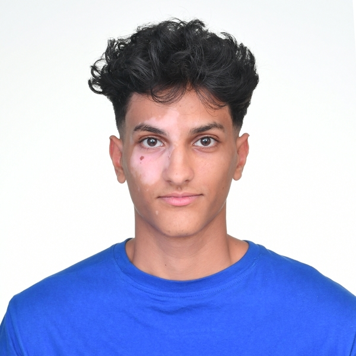

<!-- Custom terminal banner. Both theme variants are included in assets/. -->
<picture>
  <source media="(prefers-color-scheme: dark)" srcset="assets/banner-dark.svg">
  <source media="(prefers-color-scheme: light)" srcset="assets/banner-light.svg">
  
</picture>

 
 

 
 

 

&nbsp;&nbsp;

 
 

---

## This is me :)

Hi, I'm **Ahmed Rouiha**, a **Full-Stack Developer** who enjoys turning ideas into useful web applications. I like working across the stack, connecting the interface, application logic, and database to bring a product to life.

- 🚀 **Currently building:** full-stack applications with **Next.js, React, TypeScript, Prisma, and PostgreSQL**.
- 🌱 **Currently learning:** **DevOps, Docker, cloud technologies, Java, and Spring Boot**.
- 🤝 **Let's collaborate on:** open-source projects, web applications, and SaaS products.
- 🧩 **Exploring next:** cloud architecture and scalable application deployment.
- 💬 **Ask me about:** Next.js, React, TypeScript, Prisma, PostgreSQL, Docker, and web development.
- ⚡ **How I learn best:** building real-world projects and improving them one iteration at a time.

 

## My stack

Languages, frameworks, and tools I use or am learning.

 

---

## Signals

<!-- These cards describe current work and learning, without proficiency scores. -->
<table>
  <tr>
    <td width="50%" align="center" valign="top">
      <picture>
        <source media="(prefers-color-scheme: dark)" srcset="assets/focus-build-dark.svg">
        <source media="(prefers-color-scheme: light)" srcset="assets/focus-build-light.svg">
        
      </picture>
    </td>
    <td width="50%" align="center" valign="top">
      <picture>
        <source media="(prefers-color-scheme: dark)" srcset="assets/focus-learn-dark.svg">
        <source media="(prefers-color-scheme: light)" srcset="assets/focus-learn-light.svg">
        
      </picture>
    </td>
  </tr>
</table>

---

## Behind the commits

<!-- These live statistics use the services from my previous README. -->

 
 

 
 

---

**Have a project in mind? Let's build something useful.**

<a href="https://www.linkedin.com/in/ahmed-rouiha-5a5bb5335/">Connect with me on LinkedIn</a>

 
 

<code>Build. Learn. Repeat. · Ahmed Rouiha</code>

